# 🛡️ Awesome AI Agent Security 🤖

**A Curated Directory of SaaS Platforms & Open-Source Tools for AI Agent Security, Runtime Guardrails, Prompt Injection Defense, Memory Poisoning Protection & Agent Trustworthiness**

*Tracking LLM Application Security, AISPM (AI Security Posture Management), Multi-Agent Guardrails, Autonomous Agent Red Teaming & Behavioral Auditing.*

📅 **Last updated: October 2026**

---

## 📖 Overview

This repository tracks notable **SaaS platforms** and **open-source projects** for **AI Agent Security**. As autonomous AI agents gain multi-hop reasoning, external tool execution, and persistent memory capabilities, securing them against prompt injection, memory poisoning, unauthorized API tool misuse, and confidential data leakage becomes mission-critical.

* **Category Leaders:** Lakera, HiddenLayer, Protect AI, Patronus AI, Arthur Shield, Robust Intelligence (Cisco), CalypsoAI (F5), NVIDIA NeMo Guardrails, Fiddler AI, and Aporia (Coralogix).
* **Open-Source Foundations:** Strong community frameworks such as **Agent Memory Guard (OWASP)**, **NVIDIA NeMo Guardrails**, **Guardrails AI**, **LlamaFirewall (Purple Llama)**, and **PyRIT** empower developers with transparent, self-hosted runtime defense pipelines.

---

## 📑 Table of Contents

- [📊 Sector Overview & Market Dynamics](#-sector-overview--market-dynamics)
- [☁️ SaaS / Hosted Platforms](#️-saas--hosted-platforms)
- [💻 Open-Source GitHub Projects](#-open-source-github-projects)
- [🤝 How to Contribute](#-how-to-contribute)
- [💖 Support & Sponsorship](#-support--sponsorship)
- [📈 Star History](#-star-history)
- [⚠️ Disclaimer](#️-disclaimer)

---

## 📊 Sector Overview & Market Dynamics

The global AI Agent and LLM Security market is estimated at **$1.25B to $1.65B in 2025–2026** (within the broader $30B–$35B AI cybersecurity market) and is projected to surge past **$13.5B by 2032** at an annual growth rate exceeding 40%. The sector is currently **moderately fragmented**—driven by dozens of specialized AI-native startups securing agent autonomy, memory stores, and tool execution—yet experiencing rapid consolidation as cybersecurity juggernauts (Cisco, Palo Alto Networks, Check Point, F5) acquire emerging leaders.

## ☁️ SaaS / Hosted Platforms

| Platform | Company Size / Valuation | Starting Tier Price | Free Tier Limits | Description |
| :--- | :--- | :--- | :--- | :--- |
| **[NVIDIA NeMo Guardrails (NIM / Enterprise)](https://www.nvidia.com/en-us/ai-data-science/products/nemo/)** | ~$3.0T+ Market Cap | $1.00/GPU-hr on cloud marketplaces ($4,500/GPU/yr license) | 90-day evaluation trial (Free testing endpoints on build.nvidia.com) | Commercial enterprise runtime protection and microservices for programmable conversational and execution safety rails. |
| **[Arthur Shield / Arthur AI](https://www.arthur.ai/)** | ~$350M ($65M raised) | $60/month (Premium tier) | Free forever plan: Up to 4 use cases, 7-day data retention, unlimited seats | Monitoring and governance platform offering real-time runtime safety controls, prompt validation, and agent observability. |
| **[Lakera](https://www.lakera.ai/)** | ~$300M (Acquired by Check Point) | $0/month (Enterprise custom for scale) | Free forever plan (Community): 10,000 screening requests/month, 8,000 tokens/request | AI security platform specializing in prompt injection defense, agent runtime guardrails, and real-time content filtering. |
| **[Robust Intelligence](https://www.robustintelligence.com/)** | $400M (Acquired by Cisco) | Custom enterprise quote via Cisco AI Defense | Cisco AI Defense Explorer Edition (Free self-service risk evaluation & red-teaming tier) | AI security and validation platform focused on testing models and agent setups against adversarial, injection, and robustness threats. |
| **[Protect AI](https://protectai.com/)** | ~$700M ($108.5M raised) | Custom enterprise contract on AWS Marketplace | 30-day proof-of-concept enterprise evaluation (Plus unrestricted open-source security toolkits) | Enterprise AI/ML supply chain and runtime security suite covering model scanner defense, LLM vulnerability shields, and agent posture management. |
| **[CalypsoAI](https://calypsoai.com/)** | $180M (Acquired by F5) | Custom enterprise contract via F5 AI Guardrails | Guided enterprise pilot / PoC upon sales qualification (No self-serve free tier) | Enterprise AI security and inference-layer protection platform for controlling, monitoring, and securing generative AI and agent deployments. |
| **[HiddenLayer](https://hiddenlayer.com/)** | ~$156M+ raised (Series B) | Contract units on AWS Marketplace | Enterprise demo & scoped proof-of-concept trial (No public self-serve free tier) | AI security and model protection platform covering adversarial threats, model integrity, and runtime agent threat monitoring. |
| **[Fiddler AI](https://www.fiddler.ai/)** | ~$100M raised | $0.002 per trace (Developer tier) | Free forever plan: Real-time guardrail scanning (<80ms latency; trace storage excluded) | Model performance and responsible AI control plane with real-time guardrails, prompt injection detection, and agent tracing. |
| **[Patronus AI](https://www.patronus.ai/)** | ~$70M raised (Series B) | $25/month (Base platform starting tier) | Free forever plan: 30,000 scan units/month, 2-week history data retention | Automated evaluation, automated red-teaming, and safety platform detecting hallucinations, tool misuse, and unsafe agent behaviors. |
| **[Aporia](https://www.aporia.com/)** | ~$50M (Acquired by Coralogix) | Custom Scaler tier (Contact sales) | 14-day free trial (Full platform features; Starter tier $0/year for limited evaluation) | ML observability and real-time AI guardrails platform detecting drift, anomalies, hallucinations, and unsafe output generation. |

## 💻 Open-Source GitHub Projects

- **[iFixAi](https://github.com/ifixai-ai/iFixAi)**   
  Independent auditing and verification framework for AI agents to check misalignment, authority boundaries, and behavioral compliance.

- **[promptfoo](https://github.com/promptfoo/promptfoo)**   
  CLI and library for red-teaming, penetration testing, and security evaluation of LLM applications, prompts, and autonomous agent setups.

- **[DeepEval](https://github.com/confident-ai/deepeval)**   
  Open-source evaluation framework for unit testing LLM applications and agent pipelines against toxicity, hallucination, and security risks.

- **[Garak](https://github.com/NVIDIA/garak)**   
  Generative AI vulnerability scanner probing models, hallucination edges, data leakage vectors, and jailbreaks.

- **[Guardrails AI](https://github.com/guardrails-ai/guardrails)**   
  Open-source runtime validation framework and guardrails hub for enforcing structural integrity, output schema safety, and content policies.

- **[NVIDIA NeMo Guardrails](https://github.com/NVIDIA/NeMo-Guardrails)**   
  Open-source toolkit for adding programmable rails (input, output, dialog flow, retrieval, and action execution) to LLM-powered applications and agents.

- **[PyRIT (Microsoft)](https://github.com/microsoft/PyRIT)**   
  The Python Risk Identification Tool for Generative AI, Microsoft's automated red-teaming framework for identifying security and robustness flaws.

- **[LlamaFirewall / Purple Llama](https://github.com/meta-llama/PurpleLlama)**   
  Meta's open-source suite of cyber and safety evaluation tools, input/output safeguards, and agent execution defenses.

- **[LLM Guard](https://github.com/protectai/llm-guard)**   
  The security toolkit for LLM interactions offering sanitization, prompt injection detection, sensitive data leakage prevention, and output scanning.

- **[Rebuff](https://github.com/protectai/rebuff)**   
  Multi-layered prompt injection detection engine combining heuristics, dedicated vector storage of known attacks, and LLM verification.

- **[ModelScan](https://github.com/protectai/modelscan)**   
  Open-source tool designed to detect serialization and code execution vulnerabilities across AI/ML model formats (PyTorch, Pickle, Keras, etc.).

- **[Vigil](https://github.com/deadbits/vigil-llm)**   
  Open-source security scanner and firewall for detecting prompt injections, jailbreaks, and unsafe input payloads in LLM and agent pipelines.

- **[Agent Memory Guard (OWASP)](https://github.com/OWASP/www-project-agent-memory-guard)**   
  OWASP incubator project that detects and blocks memory poisoning attacks in AI agent memory stores via declarative screening rules.

- **[mguard](https://github.com/mguard-ai/mguard)**   
  Memory defense library aimed at stopping memory-poisoning style attacks (e.g., MINJA, AgentPoison) before they contaminate agent context.

- **[OWASP AI Agent Security Resources](https://owasp.org/www-project-agent-memory-guard/)**  
  Official guidelines, threat models, and contribution roadmaps for hardening agent memory and runtime behavior with open tools.

### 🛡️ Recommended Architecture Pattern

- **Memory Protection**: Intercept persistent memory read/write cycles with **Agent Memory Guard** or **mguard**.
- **Execution & Dialog Guardrails**: Wrap LLM inferences and autonomous tool calls with **NeMo Guardrails** or **Guardrails AI**.
- **Input Sanitization & Output Filtering**: Deploy **LLM Guard** or **Rebuff** to thwart direct/indirect prompt injection and confidential data leakage.
- **Continuous Red Teaming**: Audit agents and trigger automated vulnerability discovery using **promptfoo**, **PyRIT**, or **Garak**.
- **Enterprise Defense-in-Depth**: Pair open guardrails with commercial platforms (Lakera, HiddenLayer, Protect AI, CalypsoAI) for zero-day threat feeds and managed compliance.

---

## 🤝 How to Contribute

Contributions are always welcome! 🚀

1. 🍴 **Fork the repository**.
2. 🌿 **Create a feature branch**: `git checkout -b feature/new-security-tool`.
3. ✍️ **Add or update entries** in `README.md` keeping formatting consistent (name, links, factual descriptions, pricing/Stars_Badges).
4. 📬 **Submit a Pull Request** with a brief summary of the project.

---

## 💖 Support & Sponsorship

Thank you for exploring and building with **Awesome AI Agent Security**! If you find this curated security index valuable:

- ⭐ **Star this repository** to help others discover trustworthy agent security practices.
- 🍴 **Fork and share** with fellow developers, security engineers, and red teams.
- ☕ **Support the maintainer**: If you would like to buy a coffee or sponsor continuous updates, visit the [GitHub Sponsors Dashboard](https://github.com/sponsors/ishandutta2007).

---

## 📈 Star History

---

## ⚠️ Disclaimer

- This is a **community-curated index** — not exhaustive and not a commercial endorsement.
- AI agent security tools mitigate risks but do not guarantee 100% defense against all adversarial vectors. Always adhere to the principle of least privilege, enforce human-in-the-loop approvals for critical actions, and conduct regular penetration testing.

---

  <b>Built for AI security engineers, red teams, and autonomous agent builders. 🛡️🤖</b> 
  Let's keep AI agents safer, more transparent, and resilient against emerging threats.

